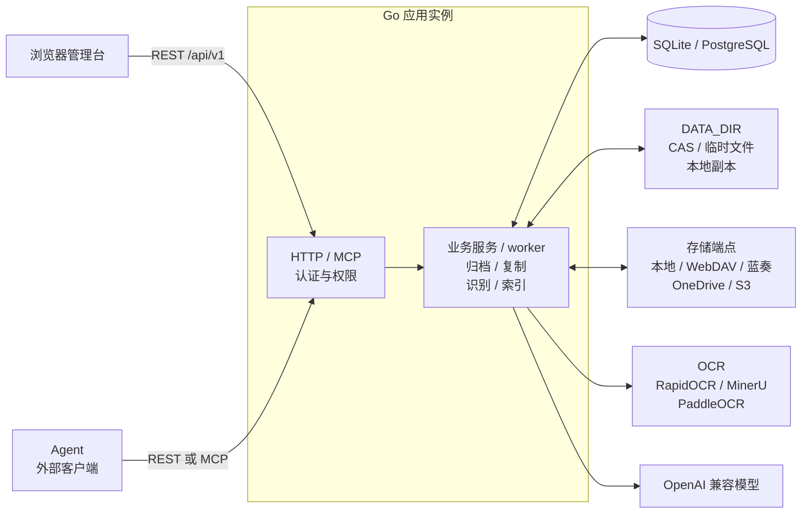
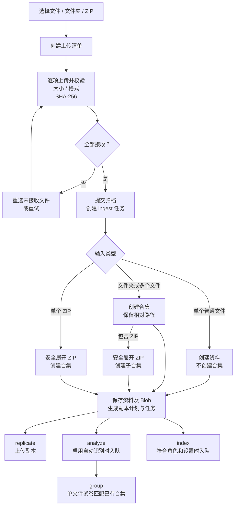
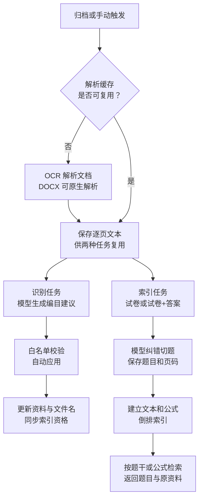

# 高中资料归档系统

高中资料（试卷、练习、课件、答案、文件夹与 ZIP 合集）的上传、归档与多点存储系统。后端 Go + Gin + GORM，前端 React + Ant Design + UnoCSS。文档入口见 [docs/README.md](docs/README.md)，技术架构与数据流见 [docs/ARCHITECTURE.md](docs/ARCHITECTURE.md)，接口见 [docs/API.md](docs/API.md)，数据结构和备份见 [docs/DATA.md](docs/DATA.md)。

[快速启动](#快速启动) · [日常操作路线](#日常操作路线) · [上传流程](#上传流程) · [搜题](#搜题) · [API 总览](#api-总览) · [测试](#测试)

## 功能与系统示意

- **上传和编目**：选择文件、文件夹或 ZIP 后直接上传；按资料、合集、学科、年级和角色整理。
- **多点存储**：原件按 SHA-256 去重，按策略生成本地或云端副本；支持查看副本和任务状态。
- **智能识别和搜题**：OCR 与模型生成资料编目建议，校验后自动应用；对试卷建立题目索引并按题干检索。
- **集成与管理**：浏览器管理台、REST API 和 MCP 共用业务逻辑与权限，支持用户、API 密钥和审计管理。



默认使用 SQLite 单连接、单实例。Compose 使用 PostgreSQL、两个应用实例和共享 `DATA_DIR`，并在内网运行 RapidOCR；每个应用实例都运行 HTTP/MCP 和 worker。任务由数据库中的租约、心跳和资料锁协调。123 云盘目前仅支持连接探测，不支持文件上传、下载和分享。

## 目录

```
backend/                 Go 服务（HTTP API、MCP、持久任务 worker）
  cmd/server/            入口
  internal/service/      领域逻辑：鉴权、资料、合集、上传、ZIP 归档、复制、任务
  internal/storage/      存储适配器（local / webdav / lanzou / 123pan / onedrive / s3）
  internal/server/       Gin 路由、DTO、MCP 适配层与集成测试
web/                     React 管理台（构建后由 Go 进程托管）
services/rapidocr/       自建中文 OCR 服务（RapidOCR + PDF 逐页渲染）
docs/ARCHITECTURE.md     分层、运行时拓扑、上传/存储/AI/检索数据流与安全边界
docs/API.md              逐字段接口合同（前后端共同依据）
docs/DATA.md             数据结构、备份与精简优化建议
docs/README.md           当前文档索引与维护约定
```

## 快速启动

前置：Go 1.26+、Node 20.19+（20.x）或 22.12+（本项目在 Go 1.27.2 / Node 22.22.3 上验证）。以下命令从项目根目录运行。

首次部署分别运行两次 `openssl rand -base64 32`，将生成的值作为 `JWT_SECRET` 和 `MASTER_KEY` 保存到安全位置。**已有数据必须继续使用原来的 `MASTER_KEY`**；不要每次启动都重新生成。

```bash
export DATA_DIR="$PWD/data"
export ADDR=127.0.0.1:8080
export ADMIN_USERNAME=admin
export ADMIN_PASSWORD='<替换为至少12个字符的初始口令>'
export JWT_SECRET='<替换为已保存的 JWT_SECRET>'
export MASTER_KEY='<替换为已保存的 MASTER_KEY>'
(cd web && npm ci && npm run build)
(cd backend && go run ./cmd/server)
```

打开 <http://127.0.0.1:8080>，用初始管理员登录。首次启动会创建管理员、默认存储策略和本地存储端点，因此不配置任何云盘也能完整归档。服务不会自动加载 `.env` 文件；每次启动时需提供相同的密钥和数据目录。管理员变量仅在空库自举时使用，修改它们不会重置已有密码。

开发模式（两个终端）：

后端终端先按上面设置环境变量，再从项目根目录执行 `(cd backend && go run ./cmd/server)`。另一个终端执行 `cd web && npm run dev`，打开 <http://127.0.0.1:5173>；Vite 将 `/api` 与 `/mcp` 代理到 `127.0.0.1:8080`。

### Docker Compose（PostgreSQL、两实例、单端口）

Docker 镜像同时包含前端、REST API、MCP 与 worker。Compose 启动独立的 PostgreSQL、一次性 schema 迁移服务、自建 RapidOCR、两个应用实例和 Nginx 网关；应用只连接内网数据库，宿主机仅暴露一个端口。两个实例共享 `paper-data` 卷中的 CAS 和本地存储。RapidOCR 只在 Compose 内网提供 `http://rapidocr:9003`，不暴露公网端口。

```bash
cp .env.example .env
# 编辑 .env，设置 ADMIN_PASSWORD、JWT_SECRET、MASTER_KEY 和 POSTGRES_PASSWORD
docker compose up -d --build
curl http://127.0.0.1:2033/healthz
```

默认访问 <http://127.0.0.1:2033>。可用 `APP_PORT` 修改宿主机端口；容器内部始终监听 `8080`。查看日志使用 `docker compose logs -f gateway app-1 app-2 rapidocr migrate`。

如果模型网关与本项目在同一台 Docker 主机上，且公网入口会中断长请求，可让应用通过可选的内部网络桥接访问它，并先把 AIProvider 地址设为 `http://app-network-proxy:3000/v1`：

```bash
NEW_API_NETWORK=new-api_new-api-network \
  docker compose -f docker-compose.yml -f deploy/docker-compose.new-api.yml up -d --build
```

桥接只加入项目网络和指定的外部网络，不发布额外端口；普通部署不需要该覆盖文件。

RapidOCR 首次执行识别时可能下载并加载中文模型；健康检查只表示服务可访问，不代表模型已加载。模型和推理依赖保存在镜像/容器中，OCR 中间文件使用 `rapidocr-jobs` 卷。容器默认最多使用 1 个 CPU 核，ONNX/OpenMP 线程数为 1；可通过 `.env` 的 `RAPIDOCR_CPUS`、`RAPIDOCR_WORKERS` 和 `RAPIDOCR_THREADS` 调整，但单机资源有限时不要同时调高。

升级自旧的单容器 SQLite 部署时，先备份 `paper-data` 卷，再在 `.env` 设置 `MIGRATE_FROM_SQLITE=/app/data/paper.db` 启动一次。迁移服务会建表并在 PostgreSQL 为空时复制现有 SQLite 数据；目标库已有用户时自动跳过。完成核对后清空该变量。旧 SQLite 文件仍保留在同一卷中，可用于回滚。

首次保存的 `JWT_SECRET` 与 `MASTER_KEY` 必须保留；更换 `MASTER_KEY` 会导致已保存的云盘、模型和 OCR 凭据无法解密。

### GitHub Actions 镜像发布与云端部署

`.github/workflows/ci.yml` 在 Pull Request 和 `main` 分支执行后端测试/vet、前端测试/typecheck/build，并校验本地与生产 Compose。`.github/workflows/docker.yml` 在 `main`、`v*` 标签和手动触发时构建并推送两个 GHCR 镜像：

- `ghcr.io/<owner>/<repo>:sha-<commit>`
- `ghcr.io/<owner>/<repo>-rapidocr:sha-<commit>`

手动运行 `Docker Build and Deploy` 并勾选 `deploy` 后，工作流会通过 SSH 上传 `deploy/docker-compose.prod.yml`、网关配置和部署脚本，在远端拉取同一提交的镜像、运行迁移、更新两个应用实例，并以网关健康检查作为成功条件；失败会恢复上一版镜像。云端目录只需预先创建 `.env`，工作流不会覆盖其中的口令、密钥和其他配置。

首次部署前，在 GitHub 仓库的 `production` Environment 或 Actions Secrets 中配置：

| Secret | 说明 |
| --- | --- |
| `DEPLOY_HOST` | 云端 SSH 地址 |
| `DEPLOY_USER` | 具备 Docker/Compose 权限的 SSH 用户 |
| `DEPLOY_PATH` | 云端绝对路径，例如 `/opt/paper-collect` |
| `DEPLOY_SSH_KEY` | SSH 私钥 |
| `DEPLOY_KNOWN_HOSTS` | `ssh-keyscan -H <host>` 的完整输出 |
| `GHCR_USERNAME` | 可读取 GHCR 包的 GitHub 用户名 |
| `GHCR_READ_TOKEN` | 具备 `read:packages` 的 PAT |

云端主机只需安装 Docker Engine 与 Compose 插件，并准备部署目录和 `.env`：

```bash
sudo install -d -o "$USER" -g "$USER" /opt/paper-collect
cp .env.example /opt/paper-collect/.env
# 编辑 /opt/paper-collect/.env，设置 ADMIN_PASSWORD、JWT_SECRET、MASTER_KEY 和 POSTGRES_PASSWORD
```

之后在 GitHub Actions 手动触发 `Docker Build and Deploy`。本地开发仍使用根目录 `docker-compose.yml` 从源码构建；云端使用 `deploy/docker-compose.prod.yml` 中固定的镜像标签，不在服务器上编译。

## 配置

| 变量 | 默认 | 说明 |
| --- | --- | --- |
| `ADDR` | `:8080` | 监听地址 |
| `DATA_DIR` | `./data` | 相对于服务进程的工作目录；保存数据库、CAS、临时文件与本地端点数据 |
| `DATABASE_DRIVER` | `sqlite` | `sqlite` 或 `postgres` |
| `DATABASE_DSN` | `DATA_DIR/paper.db` | PostgreSQL 时必须提供连接串 |
| `DB_AUTO_MIGRATE` | `true` | 是否在进程启动时建表；Compose 的 app 实例设为 `false`，由迁移服务统一执行 |
| `WEB_DIST` | `../web/dist` | 前端产物目录；不存在时只提供 API |
| `ADMIN_USERNAME` / `ADMIN_PASSWORD` | 空 | 仅空库自举管理员；密码至少 12 字符 |
| `JWT_SECRET` | 必填 | 至少 32 字符 |
| `MASTER_KEY` | 必填 | 32 字节 base64，用于 AES-256-GCM 加密存储凭据 |
| `WORKER_INSTANCE_ID` | 随机 UUID | 多实例必填且每实例唯一；SQLite 禁止设置 |
| `WORKER_INGEST_CONCURRENCY` | `1` | 每实例归档任务并发数 |
| `WORKER_REPLICATE_CONCURRENCY` | `2` | 每实例副本上传并发数 |
| `WORKER_ANALYZE_CONCURRENCY` | `2` | 每实例 AI 识别并发数 |
| `WORKER_INDEX_CONCURRENCY` | `2` | 每实例搜题索引并发数 |
| `WORKER_LEASE_DURATION` | `2m` | 任务租约；实例失联后超过此时间才可被回收 |
| `WORKER_HEARTBEAT_INTERVAL` | `20s` | 租约续期间隔，必须小于租约时长 |
| `WORKER_POLL_INTERVAL` | `2s` | 无进程内唤醒时的轮询间隔 |
| `PULL_CACHE_TTL` | `15m` | 云端副本按需拉取到临时目录后的可下载时长 |
| `POSTGRES_USER` / `POSTGRES_DB` / `POSTGRES_PASSWORD` | `paper` / `paper` / 必填 | Compose 内网 PostgreSQL；密码只放在 `.env` |
| `MIGRATE_FROM_SQLITE` | 空 | 旧 SQLite 路径；仅一次性迁移使用 |
| `RAPIDOCR_CPUS` | `1.0` | 自建 OCR 容器 CPU 核数上限 |
| `RAPIDOCR_WORKERS` | `1` | 自建 OCR 容器的任务并发数；受 CPU/内存约束 |
| `RAPIDOCR_THREADS` | `1` | 单个 RapidOCR 推理任务的线程数 |

配置缺失或非法会启动失败。生产环境请使用独立强随机值，并妥善保管 `MASTER_KEY`：丢失后已保存的云盘、模型和 OCR 凭据无法解密。数据库及文件的备份方法见 [docs/DATA.md](docs/DATA.md)。

## 日常操作路线

1. **登录和准备**：首次以管理员登录；按需在「用户」中创建账号，在「存储端点」中添加并测试端点、设置副本策略。默认本地端点已经可用，不配置云盘也能上传。
2. **上传归档**：进入「上传资料」，选择文件、文件夹或 ZIP。页面自动创建清单并开始传输；传输完成后自动提交归档。中断后在上传进度页重新选择未接收的文件，或重试失败项。
3. **整理和使用资料**：在「资料」中筛选、查看详情、编辑编目、预览 PDF/DOCX 或下载原件；在「合集」中新建合集、编辑条目与顺序。删除合集保留资料；删除资料不会删除云端对象。
4. **配置识别与搜题**：管理员在「AI 模型」添加并测试模型，在「AI 解析」配置 OCR 和自动识别；归档后的资料可在详情中查看识别结果、编辑或重新应用建议。试卷类资料建立索引后，可在「搜题」输入题干并查看页码与原资料。
5. **检查与恢复任务**：在「任务」查看归档、复制、识别和索引的进度与错误；具有 `jobs:write` 的用户可重试失败任务。存储端点可测试连接并补齐副本，资料详情可查看副本与分享状态。
6. **接入 Agent 与备份**：管理员按最小权限创建 API 密钥，用于 REST 或 MCP；定期按 [备份与恢复](docs/DATA.md#4-备份与恢复) 同时备份数据库和 `DATA_DIR`，并安全保存原 `MASTER_KEY`。

角色权限：`admin` 拥有全部权限；`editor` 可读写资料和合集、上传及查看任务；`viewer` 可读取资料、合集和任务。API 密钥的实际权限是密钥授权与所属用户当前角色权限的交集。

常见状态：上传为 `pending → processing → completed/failed`；任务为 `pending → running → succeeded/failed`，失败任务可由有权用户重试。资料达到策略最低就绪副本数后为 `archived`；没有就绪或进行中的副本且存在失败副本时为 `degraded`，其他尚未满足条件的情况为 `pending_storage`。

## 归档行为

- 上传清单先声明文件（路径、字节数），逐文件 PUT 后校验真实格式、字节数与 SHA-256，再 finalize 触发持久任务。
- ZIP 原文件上传到服务端临时区，由服务端解压；ZIP 原件本身不创建资料或存储副本，处理成功后删除临时 ZIP。单个 ZIP 形成一个合集，批次中的 ZIP 则建立子合集。保留成员原路径，尝试还原 GB18030/Big5/Shift-JIS 文件名，并拒绝路径穿越、加密文件、符号链接、重复路径与解压炸弹。
- 归档时服务端按文件名产生角色建议。角色有且只有 6 类：**试卷**（只有题）、**答案**（只有答案/答题卡）、**试卷+答案**（前面试卷，后面集中放答案）、**教师版**（每题后紧跟答案解析）、**讲义**（教程型材料，知识讲解与例题/练习混杂）、**其他**（确实无法判断）；归档后可在资料详情修改。
- 存储策略：`mirror_all`（默认，所有启用端点各一份）、`primary_backup`（同样双写，读取主端优先）、`balanced`（主端按权重选最低副本数，另写全部备端）。
- 每个副本独立记录上传状态、校验级别（uploaded/size/sha256）与分享状态。分享失败不会回滚已上传副本。
- 云端文件可按需拉取到 `DATA_DIR/tmp/material-pulls`：落盘时校验字节数和 SHA-256，返回带过期时间的鉴权下载路径；过期副本自动失效，不写入永久 CAS。TTL 由 `PULL_CACHE_TTL` 调整。

## 数据模型（简化版）

- **资料 = 一个文件**。资料名就是文件名：修改标题会同步下载文件名和本地副本名；原始内容（SHA）不变。云盘适配器没有改名接口，云端对象保留上传时的名字。
- **合集只负责摆放**。合集条目没有自己的角色，角色永远跟随资料；在资料详情改一次即可。
- **解析出的页面图不单独落盘**。AI 识别使用自建 RapidOCR、MinerU 或 PaddleOCR 的解析文本；普通 PDF 可逐页 OCR；自建 RapidOCR 直接读取 DOCX 的正文、表格、公式文本和分页提示，再对嵌入的位图执行 OCR。DOCX 的 PDF 预览缓存可能包含原文图片，与原件一样需要保护。

## 上传流程

1. 在「上传资料」选择文件、文件夹或 ZIP，选择完成后立即开始上传，无需填写表单；ZIP 原文件上传后由服务端解压。
2. 单个普通文件直接归档；多个文件或文件夹自动生成合集清单；单个 ZIP 的受支持成员形成一个合集。文件夹中的文件逐个传输并保留相对路径。
3. 管理台按文件名尽量推断标题和学科，无法判断的学科留空；归档后可编辑。全部文件接收后自动提交归档，传输中关闭页面需要重新选择未完成文件。
4. 单个普通文件归档后若 AI 识别为“试卷”，系统会尝试追加到唯一匹配的“系列”或“整套试卷”合集；只在标题、学科、年级和学年足够明确且无冲突时执行，不自动创建或改写合集。



普通文件接收时写入 CAS；ZIP 原件暂存，归档任务展开后再将成员写入 CAS。归档、复制、识别、索引和自动归类是独立任务：识别、索引或归类失败不影响原件归档与下载。

上传清单最多 2000 个文件，单个文件不超过 512 MiB，批次总大小不超过 2 GiB；每个 ZIP 展开后最多 5000 个非忽略文件、总大小不超过 2 GiB。完整限制和错误处理见 [上传接口合同](docs/API.md#清单上传与归档)。

ZIP 内的 PDF、DOC、DOCX、PPTX 和嵌套 ZIP 成员独立归档；其他格式会被跳过并提示，嵌套 ZIP 保留为成员而不递归解压。文件夹保留相对路径；上传中刷新页面后可重新选择未完成的文件。页面显示上传及服务端处理进度。

资料详情支持预览 PDF 和 DOCX；DOCX 首次预览或点击「下载 PDF」时由服务端转换，另可下载未经修改的 DOCX 原件。转换需要 LibreOffice Writer 和文档使用的字体，项目容器镜像已包含 Writer 和 Noto CJK。缺失字体、复杂版式或公式可能与 Word 显示不同；加密文档及外部引用资源需要先在 Word 中处理后再预览或使用自建 OCR。

## 智能识别（LLM + OCR）

- 系统管理 →「AI 模型」：添加多个 OpenAI 兼容端点（Base URL、API Key、优先级、启停），「探测模型」会调用 `GET /models` 并填充候选列表；可分别指定默认文本模型与视觉模型，支持最小对话测试。密钥加密保存且不回显。
- 系统管理 →「AI 解析」：新增并选择 OCR 服务商。推荐选择 `RapidOCR（自建）`，Compose 内地址为 `http://rapidocr:9003`，无需令牌；也可配置 PaddleOCR（`https://paddleocr.aistudio-app.com`、`PP-OCRv6`）或 MinerU。PaddleOCR 令牌从 [AI Studio PaddleOCR 任务页](https://aistudio.baidu.com/paddleocr/task) 获取。自建服务当前使用 RapidOCR 3.10 默认的 PP-OCRv6 small；设置中的模型名称不会切换其模型。
- 归档后，启用「自动识别」时会对每个非 ZIP 资料自动排队。识别成功后，服务端立即应用通过白名单校验的标题、学科、年级、学年、角色和标签，并同步润色后的文件名；不需要人工确认。ZIP 容器本身不分析，展开成员各自分析。
- 单文件上传且角色为“试卷”时，识别成功后还会排队 `group` 任务。它只会在已有 `series`/`exam` 合集中寻找唯一的高置信度匹配，标题会忽略“答案、解析、教师版、学生版、答题卡”等角色词；学科、年级或学年冲突、重复试卷或接近并列候选时保持独立。只追加条目，不自动创建、合并、移动或拆分合集；答案资料目前不会自动入队，无匹配也会在任务日志说明原因。
- 资料详情 →「AI 识别」可查看状态、置信度、解析文本和是否已自动应用；仍可人工编辑，或点击「重新应用建议」进行纠偏。自动应用和手动重应用都会写审计。
- 链路：归档完成后按用户选择的 OCR 服务商解析 PDF/DOC/DOCX/PPTX → 阅读正文生成建议 → 服务端校验并自动应用 → 更新资料和文件名。**归类依据正文，文件名只作辅助**；正文与文件名冲突时以正文为准。长文档保留开头和末尾，确保卷末答案区参与判断；没有解析出正文或页面图像时任务失败，不按文件名猜。自建 RapidOCR 原生处理 PDF、PNG、JPEG、WebP、BMP、TIFF；DOCX 由 Go 直接解析 OOXML，不经过 LibreOffice 或 PDF 文本层。识别与搜题索引可复用同一文件的解析文本；切换服务商、地址或模型会自动失效缓存。
- 未配置 OCR 服务商/令牌或没有可用模型时，识别任务会明确失败，不影响归档与副本上传。
- 自建 RapidOCR 对 DOCX 的原生解析覆盖段落、标题、表格、文本框、公式、显式/渲染分页和嵌入位图；常见 Word 原生公式的分式、上下标、根号等会保留为 LaTeX。图片 OCR 有数量和体积上限，单张图片失败不会丢弃正文。页码来自显式分页或 Word 保存的 `lastRenderedPageBreak`，没有分页提示的连续文档按第 1 页处理，搜题页码可能与 Word 显示不同。复杂公式和图片文字仍需检查；升级应用时无需同步升级 RapidOCR 镜像（图片 OCR 使用原有接口）。



自动识别默认关闭；题目索引默认启用，仍需可用的 OCR 与模型。两条任务链按各自设置和资料角色运行，共享符合条件的解析缓存，并非每份资料都会同时执行两种任务。

## 搜题

- 「搜题」入口：输入题干或公式，结果优先展示并高亮匹配文段，完整题目可按需展开；支持分页并可查看页码、原试卷与合集。同一题多卷按多条结果返回。PDF 原卷在站内预览并定位到对应页，预览失败可重试，也可在新窗口打开当前页；非 PDF 原卷跳转到资料详情。
- 上游提供的公式文本和受支持的 Word 原生公式会保留运算符及常见结构，可搜索 `x+y`、`x²+1`、`x^{2}+1` 或 `\frac{x}{y}` 等写法；`x+y` 与 `x-y` 不会混为同一公式。支持常见符号写法归一化，不进行通用代数等价推导；公式仍以文本/LaTeX 返回。当前 RapidOCR 尚未接入扫描件公式识别模型。
- 索引（默认启用）：仅角色为“试卷”或“试卷+答案”的资料会自动入队 `index` 任务；AI 识别应用角色或人工修改角色后也会同步入队/清理，关闭索引期间归档的试卷资料会在重新启用后由启动补建。OCR 只取逐页文本，LLM 默认每批 10 页/12000 字（可配置）完成 OCR 纠错与切题并标注页码；长页按段落切块，输出截断时自动对半拆批。题目保存完整题干（含选项/小问），支持文本和公式倒排检索。
- 资料详情「题目索引」可查看页码/题目/置信度；有资料写权限的用户可重建索引。
- 索引失败不影响归档与下载；重建失败时旧索引仍可查，搜索只返回已有题目且资料状态为 `archived`/`degraded` 的记录。
- 升级时需先执行数据库迁移（Compose 的 `migrate` 服务会执行）；随后后台根据已保存的题干补建公式词项，不调用 OCR 或模型，首次公式搜索可能等待补建。旧题干中已经丢失的公式结构无法从词项恢复，原生 DOCX 资料可在详情中「重建索引」，从原件重新解析并调用切题模型。

## 观测与数据下钻

- 顶栏「网络」会在当前浏览器会话内采集最近的 API、下载和上传：P95/平均/中位延迟、成功率、累计传输量、在途请求、每次请求的耗时、响应大小和 request ID。采样只存在内存，不记录正文、凭据或查询参数；「清空」会重置历史聚合。
- 后端对每个 `/api/*` 与 `/mcp` 请求输出 `method/path/status/duration_ms/response_bytes/request_id`，可用于把页面上的 request ID 与运行日志直接对应。查询参数、请求体和响应正文不写入该日志。
- 资料、合集、任务列表和仪表盘最近记录支持点击整行进入详情；移动端可直接点击整张卡片。标题链接和行内按钮仍执行各自操作，不会触发二次跳转。
- 仪表盘统计卡可进入对应资料或任务筛选；资料详情可跳到所在合集、相关任务、同内容资料和存储端点，合集与任务列表也保留反向查询。
- 内容指纹只用于 Blob 去重：相同文件不会重复占用存储，但不同文件名/归档来源仍是独立逻辑资料。资料详情可直接查看所有同 SHA-256 的逻辑资料。

## 鉴权

- 浏览器：用户名口令登录，得到 15 分钟 JWT 与可轮换 refresh token。
- Agent：管理员创建 API 密钥（仅创建时显示一次，默认长期有效），直接用 `Authorization: Bearer <密钥>` 访问 REST 和 MCP。每次请求回查密钥、用户和当前权限，撤销密钥或禁用用户后立即失效；旧 `pc_` 密钥也可直接使用。
- MCP：`POST /mcp`，无状态 JSON-RPC（initialize / tools/list / tools/call），按授权提供与管理台同步的查询、写入、上传和管理工具。客户端配置、完整参数和调用示例见 [MCP 接入指南](docs/MCP.md)。

## API 总览

以下是当前服务的完整路由索引。除健康检查、MCP 和下文的 RapidOCR 内网接口外，路径均以 `/api/v1` 为前缀；例如 `/materials` 的完整路径是 `/api/v1/materials`。`{id}` 和 `{entry_id}` 表示服务端返回的标识。字段、筛选参数、状态码和错误码以 [HTTP API 合同](docs/API.md) 为准。

除登录和刷新外，业务接口都要求 `Authorization: Bearer <access JWT 或 API 密钥>` 及表中权限；退出登录用于注销浏览器会话，不会撤销 API 密钥。成功的 JSON 响应为 `{"data": ..., "request_id": "..."}`，错误为 `{"error": {"code": "...", "message": "..."}, "request_id": "..."}`；二进制传输、无响应体和 MCP 使用各自的响应格式。

### 服务、认证与管理

| 方法 | 路径 | 用途 | 权限 |
| --- | --- | --- | --- |
| `GET` | `/healthz` | 应用健康检查；无 `/api/v1` 前缀 | 公开 |
| `POST` | `/mcp` | MCP JSON-RPC；无 `/api/v1` 前缀 | API 密钥，按工具检查权限 |
| `POST` | `/auth/login` | 用户名、密码登录 | 公开 |
| `POST` | `/auth/refresh` | 轮换 refresh token 并获取新会话 | 公开 |
| `POST` | `/auth/logout` | 注销浏览器会话 | 已认证 |
| `GET` | `/auth/me` | 当前用户 | 已认证 |
| `GET` | `/subjects` | 学科字典 | `materials:read` |
| `GET` | `/users` | 用户列表 | `users:manage` |
| `POST` | `/users` | 创建用户 | `users:manage` |
| `GET` | `/api-keys` | API 密钥列表 | `keys:manage` |
| `POST` | `/api-keys` | 创建密钥，明文仅返回一次 | `keys:manage` |
| `DELETE` | `/api-keys/{id}` | 撤销密钥 | `keys:manage` |
| `GET` | `/audit-logs` | 审计日志 | `audit:read` |

### 资料与合集

| 方法 | 路径 | 用途 | 权限 |
| --- | --- | --- | --- |
| `GET` | `/materials` | 筛选和分页查询资料 | `materials:read` |
| `GET` | `/materials/stats` | 资料数量与归档状态统计 | `materials:read` |
| `GET` | `/materials/{id}` | 资料详情、所属合集与副本 | `materials:read` |
| `PATCH` | `/materials/{id}` | 编辑编目字段和文件名 | `materials:write` |
| `DELETE` | `/materials/{id}` | 删除资料，可指定级联 | `materials:write` |
| `GET` | `/materials/{id}/download` | 下载原件 | `materials:read` |
| `GET` | `/materials/{id}/preview` | 预览 PDF 或 DOCX 转换后的 PDF | `materials:read` |
| `POST` | `/materials/{id}/pull-cache` | 从云端副本拉回并校验临时文件 | `materials:read` |
| `GET` | `/materials/{id}/pull-cache` | 下载尚未过期的临时文件 | `materials:read` |
| `POST` | `/materials/{id}/analysis` | 创建或重跑识别任务 | `materials:write` |
| `GET` | `/materials/{id}/analysis` | 读取识别结果 | `materials:read` |
| `POST` | `/materials/{id}/analysis/apply` | 重新应用识别建议 | `materials:write` |
| `GET` | `/materials/{id}/questions` | 资料中的题目列表 | `materials:read` |
| `GET` | `/materials/{id}/index` | 题目索引状态 | `materials:read` |
| `POST` | `/materials/{id}/index` | 创建或重建题目索引 | `materials:write` |
| `GET` | `/collections` | 查询合集 | `collections:read` |
| `POST` | `/collections` | 创建合集 | `collections:write` |
| `GET` | `/collections/{id}` | 合集详情与条目 | `collections:read` |
| `PATCH` | `/collections/{id}` | 编辑合集 | `collections:write` |
| `PUT` | `/collections/{id}/items` | 整体替换合集条目及顺序 | `collections:write` |
| `DELETE` | `/collections/{id}` | 删除合集，可级联子合集；资料保留 | `collections:write` |

### 上传与任务

| 方法 | 路径 | 用途 | 权限 |
| --- | --- | --- | --- |
| `POST` | `/uploads` | 创建文件清单 | `uploads:write` |
| `GET` | `/uploads/{id}` | 查询清单和接收进度 | `uploads:write` |
| `PUT` | `/uploads/{id}/files/{entry_id}` | 上传一个条目的二进制文件 | `uploads:write` |
| `POST` | `/uploads/{id}/finalize` | 全部接收后提交归档 | `uploads:write` |
| `GET` | `/jobs` | 筛选和分页查询任务 | `jobs:read` |
| `GET` | `/jobs/stats` | 任务数量与状态统计 | `jobs:read` |
| `GET` | `/jobs/{id}` | 任务进度、错误与日志 | `jobs:read` |
| `POST` | `/jobs/{id}/retry` | 重试失败任务 | `jobs:write` |

### 存储与副本

| 方法 | 路径 | 用途 | 权限 |
| --- | --- | --- | --- |
| `GET` | `/storage/providers` | 存储端点列表 | `storage:read` |
| `POST` | `/storage/providers` | 创建存储端点 | `storage:write` |
| `PATCH` | `/storage/providers/{id}` | 修改或停用端点 | `storage:write` |
| `POST` | `/storage/providers/{id}/test` | 测试端点连接 | `storage:write` |
| `GET` | `/storage/policy` | 读取副本策略 | `storage:read` |
| `PUT` | `/storage/policy` | 更新副本策略与最低副本数 | `storage:write` |
| `POST` | `/storage/reconcile` | 按策略补建副本及任务 | `storage:write` |
| `POST` | `/storage/replicas/{id}/share` | 创建或刷新副本分享 | `storage:write` |

### AI、OCR 与搜题

| 方法 | 路径 | 用途 | 权限 |
| --- | --- | --- | --- |
| `GET` | `/ai/providers` | 模型端点列表 | `ai:read` |
| `POST` | `/ai/providers` | 创建模型端点 | `ai:write` |
| `PATCH` | `/ai/providers/{id}` | 修改或停用模型端点 | `ai:write` |
| `POST` | `/ai/providers/probe` | 使用提供的配置探测模型 | `ai:write` |
| `POST` | `/ai/providers/{id}/probe` | 使用已保存配置探测模型 | `ai:write` |
| `POST` | `/ai/providers/{id}/test` | 测试模型对话 | `ai:write` |
| `GET` | `/ocr/providers` | OCR 服务商列表 | `ai:read` |
| `POST` | `/ocr/providers` | 创建 OCR 服务商 | `ai:write` |
| `PATCH` | `/ocr/providers/{id}` | 修改或停用 OCR 服务商 | `ai:write` |
| `POST` | `/ocr/providers/{id}/test` | 测试 OCR 服务商 | `ai:write` |
| `GET` | `/ai/settings` | 读取自动识别及 OCR 设置 | `ai:read` |
| `PUT` | `/ai/settings` | 更新自动识别及 OCR 设置 | `ai:write` |
| `POST` | `/ai/mineru/test` | 兼容旧客户端，测试当前 OCR 服务商 | `ai:write` |
| `POST` | `/search/questions` | 按题干及条件搜索题目 | `materials:read` |
| `GET` | `/search/questions/{id}` | 题目详情 | `materials:read` |
| `GET` | `/search/settings` | 读取索引设置 | `search:read` |
| `PUT` | `/search/settings` | 更新索引设置 | `search:write` |

### MCP 与内部 OCR 接口

MCP 使用 API 密钥访问 `POST /mcp`，支持 `initialize`、`ping`、`tools/list` 和 `tools/call`。工具覆盖上表中的账户、资料、合集、上传、任务、存储、AI/OCR、搜题与管理操作；浏览器登录、刷新和退出没有对应工具。`tools/list` 只列出当前密钥有权使用的工具；完整工具名、REST 映射和文件传输方式见 [MCP 工具与权限](docs/MCP.md#3-工具与权限)。小文件可经 MCP Base64 上传，较大文件及下载使用返回的 REST 路径与同一 Bearer 密钥流式传输。

MCP 使用单条 JSON-RPC 消息和 JSON 响应，不提供 SSE、批处理或会话 ID；`GET`、`PUT`、`DELETE /mcp` 返回 405。

自建 RapidOCR 是独立的**内网服务**，下面的路径相对于它自己的地址（Compose 中为 `http://rapidocr:9003`），不是应用的 `/api/v1` 接口，也不使用应用的 Bearer 鉴权：

| 方法 | 路径 | 用途 |
| --- | --- | --- |
| `GET` | `/healthz` | OCR 服务健康检查 |
| `POST` | `/api/v1/ocr/jobs` | 上传 PDF 或图片，创建异步 OCR 任务 |
| `GET` | `/api/v1/ocr/jobs/{job_id}` | 查询 OCR 状态和结果地址 |
| `GET` | `/api/v1/ocr/jobs/{job_id}/result` | 下载逐页 JSONL 结果 |
| `GET` | `/openapi.json` | FastAPI 自动生成的接口描述 |

### 典型 API 调用顺序

1. 浏览器调用 `POST /api/v1/auth/login` 获取会话；Agent 直接使用已授权的 API 密钥。后续请求携带 Bearer 凭据。
2. 调用 `POST /api/v1/uploads` 创建清单，对返回的每个条目调用 `PUT /api/v1/uploads/{id}/files/{entry_id}` 上传原始字节；全部接收后调用 `POST /api/v1/uploads/{id}/finalize`。
3. 通过 `GET /api/v1/jobs/{id}` 查看返回的归档任务，通过 `GET /api/v1/uploads/{id}` 查看最终 `material_id` 或 `collection_id`，再读取资料或合集详情；原件下载和 PDF 预览使用相应的资料接口。
4. 按需调用资料的 `analysis` 或 `index` 接口触发任务并查询状态；索引完成后使用 `POST /api/v1/search/questions` 搜题。副本、模型和 OCR 配置分别使用上表中的存储和 AI 管理接口。

## 测试

```bash
(cd backend && go test ./... && go vet ./... && go build ./cmd/server)
(cd web && npm run typecheck && npm test && npm run build)
```

RapidOCR 协议测试覆盖上传、轮询、JSONL 结果解析，并曾用远端 Compose 中的真实 6 页扫描 PDF 完成 OCR 和分析。

后端集成测试使用临时 SQLite 与模拟上游，覆盖直传单文件/文件夹/ZIP、恶意 ZIP 拒绝、旧 ZIP 任务兼容、上传→服务端解压→合集→本地副本、AI 分析与索引共享解析、Agent 单一 Bearer/MCP/撤销、未鉴权 401。前端测试覆盖清单路径/大小/格式、上传默认值与直传载荷、搜题高亮、AI 格式/权限、存储字段表与 API envelope。

## 当前能力边界

- **智能识别**：协议测试覆盖 OpenAI 兼容接口、MinerU、PaddleOCR 与 RapidOCR 自建服务。已在德国部署环境用真实 6 页扫描试卷验证 RapidOCR 全链路：OCR 约 20 秒，随后模型分析成功；PaddleOCR 跨境任务在同一试卷上约 8 分钟。DOCX 原生解析已用包含标题、表格、图片、公式和分页的样例验证；真实 Word 版式、PPT、其他扫描件和上游限流仍未系统验证。
- **搜题**：切题与页码准确率、长文档成本、上游限流未用真实试卷系统验证；索引失败不影响归档与下载，重建失败时旧索引仍可查。
- **删除**：资料/合集支持级联删除；会清理目录记录、合集条目、分析文件、题目索引/解析缓存与本地副本，但云盘适配器没有删除接口，远端文件会留在云盘。
- **123 云盘**：因开放平台文档无法访问，只实现 access_token 与健康探测；上传/下载/分享明确返回 `unsupported`（`123pan_upload_unverified` 等），**不要把它作为可上传端点启用**。
- **蓝奏云**：按非官方协议（上传、`task=22` 分享、直链解析）实现并用协议测试覆盖，未对真实服务联调；旧版分享页解析已移除，部分旧链接可能无法下载。单文件上限 100 MiB，默认校验级别为 `uploaded`。
- **WebDAV**：协议测试覆盖，未与真实服务联调；标准不含分享接口，只有配置 `public_base_url` 时才返回公开链接。
- **OneDrive**：使用国际版微软端点，不支持中国世纪互联版和政府云。可选 OpenList 提供的现成应用，或自己的微软应用；均需刷新令牌。可选有写权限的共享文件夹链接，也可创建查看链接。仅有分享链接不能作为写入端点。未与真实 OneDrive 联调。
- **S3**：支持 AWS S3 和兼容服务，分段上传并生成限时签名链接；链接过期后可在资料详情刷新。未与真实 S3 联调。
- 不提供通用全文检索、通用 Office 格式转换（DOCX 转 PDF 预览除外）、病毒扫描与云盘物理删除。
- worker 使用数据库租约和心跳。SQLite 仍只允许单实例；PostgreSQL 支持多实例，必须为每个实例设置唯一的 `WORKER_INSTANCE_ID`。多实例共享同一数据库，且 `DATA_DIR`（CAS 和本地存储）必须位于所有实例都能访问的共享文件系统。

配置 OneDrive 时，可在“存储端点”选择“使用 OpenList 提供的应用”，打开 [OpenList Token](https://api.oplist.org/)，选择国际版个人或企业 OneDrive，勾选“使用 OpenList 提供的参数”并完成微软授权，将获取的刷新令牌填回本系统。该第三方应用请求 `Files.ReadWrite.All` 和 `offline_access`；每次续期都会向 OpenList 发送刷新令牌，其接口将令牌放在 URL 查询参数中，服务提供方或中间环节可能记录该地址。请确认信任该服务，或选择自己的微软应用。自建应用需在 Microsoft Entra 注册应用，授予 `Files.ReadWrite` 与 `offline_access` 并获取刷新令牌；机密客户端还需应用程序密钥，参考 [Microsoft Graph 用户授权](https://learn.microsoft.com/en-us/graph/auth-v2-user)。切换授权方式需填写对应应用新取得的刷新令牌。可选填共享文件夹链接，但授权账号必须拥有写权限；刷新令牌加密保存并在轮换时更新。分享范围可选持链接查看、组织内查看或关闭；组织策略可能禁止匿名分享。连接测试只检查文件夹可访问，不能保证写入成功。

配置 S3 时填写存储桶、区域和访问密钥；使用兼容服务时可填写服务地址，并按服务要求启用路径式访问。可设置分享链接有效期；签名链接受凭据有效期和服务端策略约束。所有真实云服务的权限与可用性需在实际环境验证。
